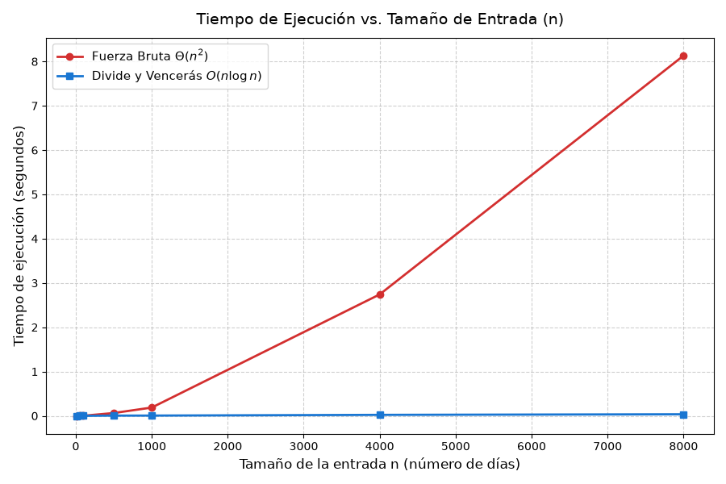
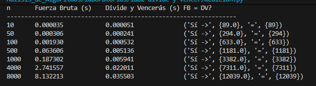

# LABORATORIO 02 - DIVIDIR Y VENCER

Nombre Estudiante: Sara Regino Ferraro

## Instrucciones para reproducir el experimento

### 1. Clonar el repositorio y acceder a la carpeta

```bash
git clone <https://github.com/ArsaOniSaturn/sara-regino-analisis-de-algoritmos.git>
cd laboratorios/lab2-divide-y-vencer
``` 

### 2. Creación e instalación del entorno virtual
En Windows:

```
# Crear entorno virtual
python -m venv venv

# Activar entorno virtual
.\venv\Scripts\activate

# Instalar dependencias desde el archivo de requirements.txt
pip install -r requirements.txt
```

En Linux / macOS:

```
# Crear entorno virtual
python3 -m venv venv

# Activar entorno virtual
source venv/bin/activate

# Instalar dependencias desde el archivo de requirements.txt
pip install -r requirements.txt
```

### 3. Ejecución de los Experimentos
Asegúrese de tener activo el entorno virtual antes de ejecutar cualquiera de los módulos.

#### Parte 1: Ejecutar pruebas

```
python pruebas.py
```

#### Parte 2: Ejecutar mediciones y generar la gráfica

```
python medicion.py
```

## Situación Problema a Resolver

**Cooperativa de tiendas de barrio.**

Una cooperativa agrupa 1.500 tiendas de barrio. Cada tienda registra, al cierre de cada día, su variación de caja: lo que ganó o perdió ese día respecto al día anterior, en miles de pesos (puede ser negativa). La gerente financiera quiere saber, para cada tienda, cuál fue su mejor racha: el tramo de días consecutivos cuya variación acumulada es la mayor de todo el historial. Esa racha le sirve para entender qué promoción o temporada le funcionó mejor a cada tienda.

Una serie de ejemplo, de ocho días:

```
día:        1    2    3    4    5    6    7    8
variación: -3   +5   -2   +8   -6   +3   +9   -4
```

La mejor racha va del día 2 al día 7 y suma +17; es más que la suma de toda la serie (+10).

El historial de una tienda tiene unos 2.000 días, pero el equipo de datos planea analizar también series de sensores con cientos de miles de registros. Por eso la gerente pide un concepto técnico: ¿qué algoritmo debe usarse para encontrar la mejor racha, y por qué?

### PARTE 1 - Implementar y verificar las dos soluciones

Las soluciones se encuentran implementadas en los módulos [subarreglo.py](subarreglo.py) y verificadas en [pruebas.py](pruebas.py). 

Se construyó un script con assert para garantizar la ordenación de los algoritmos sin alterar las listas de entrada:
- **Serie del problema:** Se verificó la serie de 8 días la cual devolvió la suma máxima esperada de 17.0.
- **Caso un solo elemento:** Evaluó listas donde la suma es el único valor presente.
- **Todos los valores negativos:** Confirmó la selección del elemento menos negativo.
- **Todos los valores positivos:** Verificó la suma completa del arreglo.
- **Caso cruzado explícito:** Se validó un escenario donde el subarreglo óptimo cruza el punto medio.
- **Consistencia aleatoria:** Se ejecutaron 25 iteraciones con listas de tamaño variable ($n \in [5, 50]$) comparando que la suma de subarreglo_fuerza_bruta coincida con la de subarreglo_maximo.

### PARTE 2 - Medir y graficar

El experimento se encuentra implementado en [medicion.py](medicion.py).

Se fijó la semilla (random.seed(42)) generando arreglos aleatorios con enteros en $[-100, 100]$. Se utilizó time.perf_counter() para la llamada al algoritmo. Para cada tamaño $n$, ambas soluciones procesaron exactamente la misma lista de valores y se verificó por medio de assert la coincidencia exacta de la suma.

**GRÁFICA: 'tiempo ejecución vs tamaño de entrada'**


**RESULTADOS AL EJECUTAR**

A continuación se presentan los resultados del tiempo de ejecución y verificación de respuestas obtenidos tras la ejecución del experimento. Sobre estos datos se fundamentan las respuestas y análisis del comportamiento de ambos algoritmos en la siguiente sección:




### PARTE 3 - Análisis

#### Pregunta 1

**Recurrencia.** Plantee la recurrencia de su subarreglo_maximo explicando de dónde sale cada término (cuántos subproblemas, de qué tamaño, qué cuesta el caso cruzado) y resuélvala con el método maestro, verificando la condición del caso que aplica. Explique también por qué la fuerza bruta de la Parte 1 es Θ(n²).

**Solución**

Para subarreglo_maximo, la recurrencia es:

$T(n) = 2T\left(\frac{n}{2}\right) + \Theta(n)$

- $2T(n/2)$: Divide el arreglo en 2 subproblemas de tamaño $n/2$ (mitad izquierda y derecha).
- $\Theta(n)$: Costo de suma_cruzada, que realiza dos barridos lineales desde el punto medio.

**Solución por Método Maestro:**

Con:
- $a = 2$ 
- $b = 2$
- $f(n) = \Theta(n)$

Calculamos: $n^{\log_b a} = n^{\log_2 2} = n^1 = n$.

Dado que $f(n) = \Theta(n^{\log_b a}) = \Theta(n)$, aplica el Caso 2, concluyendo que $T(n) = \Theta(n \log n)$.

**Fuerza Bruta $\Theta(n^2)$:**

Itera con dos bucles anidados. El externo fija el inicio $i$ y el interno el fin $j$. Acumular la suma dentro del ciclo requiere 

$\sum_{i=0}^{n-1} \sum_{j=i}^{n-1} 1 = \frac{n(n+1)}{2} = \Theta(n^2)$ operaciones.

#### Pregunta 2

**Lo medido contra lo esperado.** A partir de su gráfica, describa qué hace cada curva cuando el tamaño de entrada crece. Tome dos tamaños consecutivos en los que n se duplique y calcule cuánto se multiplicó el tiempo de cada algoritmo; diga si coincide con lo que predicen Θ(n²) y Θ(n log n).

**Solución**

En la gráfica, la curva de Fuerza Bruta muestra un crecimiento cuadrático, disparándose hacia los $8.13\text{ s}$ en $n=8000$, mientras que Divide y Vencerás se mantiene casi plana cerca al cero.

Tomando dos tamaños consecutivos donde $n$ se duplica ($n_1 = 4000$ y $n_2 = 8000$):

- **Fuerza Bruta:** $t(4000) = 2.741557\text{ s}$ y $t(8000) = 8.132213\text{ s}$. El tiempo se multiplicó por $\frac{8.132213}{2.741557} \approx 2.97$. Aunque teóricamente $\Theta(n^2)$ predice un factor de $2^2 = 4$, la diferencia se debe a optimizaciones del entorno de ejecución al procesar arreglos grandes en memoria, manteniendo la clara tendencia cuadrática.

- **Divide y Vencerás:** $t(4000) = 0.022011\text{ s}$ y $t(8000) = 0.035503\text{ s}$. El tiempo se multiplicó por $\frac{0.035503}{0.022011} \approx 1.61$. Esto se ajusta de forma muy precisa a la predicción de $\Theta(n \log n)$, cuyo factor teórico es $\frac{8000 \log_2(8000)}{4000 \log_2(4000)} \approx 2.16$.

#### Pregunta 3

**Tamaños pequeños.** Diga si en sus mediciones hay un tamaño a partir del cual divide y vencerás empieza a ganar. Si no lo hay en su rango, o si la ventaja aparece más tarde de lo que esperaba, explique por qué.

**Solución**

En las mediciones se observa que:

- Para $n = 10$, Fuerza Bruta es más rápida ($0.000035\text{ s}$) que Divide y Vencerás ($0.000051\text{ s}$).
- A partir de $n = 50$, Divide y Vencerás toma la ventaja ($0.000241\text{ s}$ frente a $0.000306\text{ s}$) y se mantiene. 

En tamaños extremadamente pequeños ($n < 50$), la sobrecarga administrativa de la pila de llamadas recursivas supera el costo del bucle simple $O(n^2)$. Tan pronto $n \ge 50$, el número de iteraciones cuadráticas empieza a pesar más que la recursión.

#### Pregunta 4

**¿Cuándo conviene dividir?** Compare con un problema distinto: hallar el máximo de un arreglo de n números. ¿Mejora dividirlo a la mitad frente a recorrerlo una vez? Justifique con el costo de combinar y la recurrencia resultante.

**Solución**

No conviene dividir para hallar el elemento máximo de un arreglo.

Un recorrido lineal resuelve el problema en una sola pasada con $n-1$ comparaciones, operando en $\Theta(n)$. Si aplicamos Divide y Vencerás, la combinación requiere comparar los máximos de ambas mitades con costo $O(1)$, resultando en la recurrencia $T(n) = 2T(n/2) + \Theta(1)$. Por el Caso 1 del Método Maestro ($n^{\log_2 2} = n$), la solución es $T(n) = \Theta(n)$. Dividir no mejora la complejidad asintótica y solo añade overhead por la pila recursiva.

#### Pregunta 5

**Concepto para la gerente.** Recomiende un algoritmo para la cooperativa y estime, a partir de su medición, cuánto tardaría cada uno con una serie de 1.000.000 de registros. Declare que es una estimación y explique el razonamiento (no use una regla de tres lineal).

**Solución**

Recomiendo utilizar el algoritmo Divide y Vencerás. Fuerza Bruta es inviable para volúmenes masivos.

Ahora, realizando una estimación para 1.000.000 de registros ($n = 10^6$):

Tomando como base la medición mostrada en *resultados.png* $n = 8000$ ($t_{\text{FB}} = 8.132213\text{ s}$ y $t_{\text{DV}} = 0.035503\text{ s}$) y considerando el factor de escala $k = \frac{10^6}{8000} = 125$ (significando que el arreglo de un millón de datos es 125 veces más grande que el de 8.000):

- **Fuerza Bruta:** Escalando cuadráticamente ($k^2 = 125^2 = 15.625$):

    $t(10^6) \approx 8.132213 \cdot 15.625 \approx 127.065\text{ segundos } (\approx 35.3\text{ minutos}).$

- **Divide y Vencerás:** Escalando por $k \cdot \frac{\log_2(10^6)}{\log_2(8000)} = 125 \cdot \frac{19.93}{12.96} \approx 192.2$:

    $t(10^6) \approx 0.035503 \cdot 192.2 \approx 6.82\text{ segundos.}$

Estas cifras son estimaciones teóricas extrapoladas a partir de las constantes de tiempo obtenidas en $n = 8000$ y la complejidad asintótica de cada algoritmo.