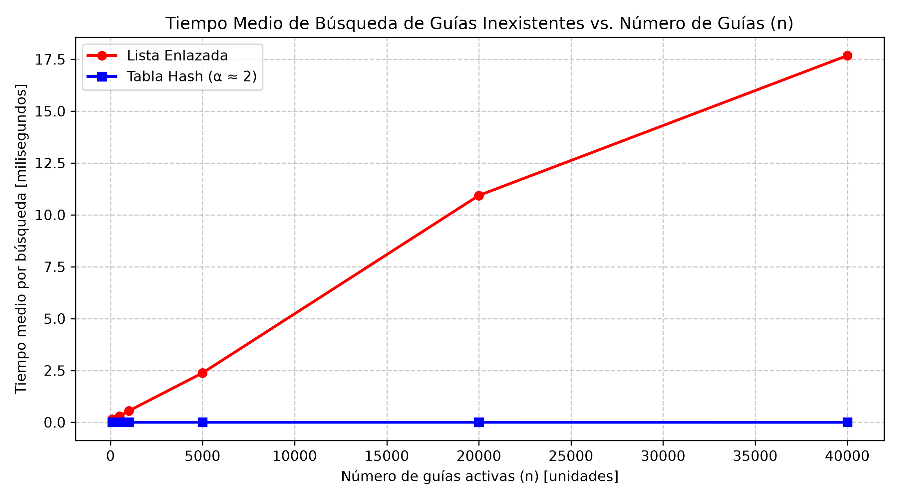
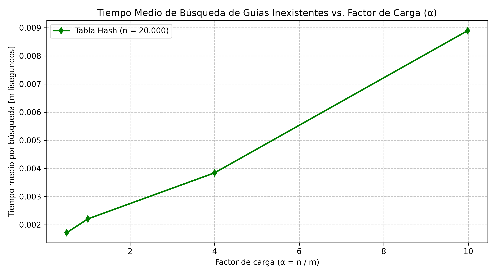

# LABORATORIO 03 - ESTRUCTURAS DE DATOS

Nombre Estudiante: Sara Regino Ferraro

## Instrucciones para reproducir el experimento

### 1. Clonar el repositorio y acceder a él

```bash
git clone https://github.com/ArsaOniSaturn/sara-regino-analisis-de-algoritmos.git
cd sara-regino-analisis-de-algoritmos
``` 

### 2. Creación e instalación del entorno virtual
En Windows:

```
# Crear entorno virtual
python -m venv venv

# Activar entorno virtual
.\venv\Scripts\activate

# Instalar dependencias desde el archivo de requirements.txt
pip install -r requirements.txt
```

En Linux / macOS:

```
# Crear entorno virtual
python3 -m venv venv

# Activar entorno virtual
source venv/bin/activate

# Instalar dependencias desde el archivo de requirements.txt
pip install -r requirements.txt
```

### 3. Ejecución de los Experimentos
Una vez activado el entorno virtual, diríjase a la carpeta del laboratorio:

```
cd laboratorios/lab3-estructuras-datos
```

#### Parte 1: Ejecutar pruebas

```
python pruebas.py
```

#### Parte 2: Ejecutar mediciones y generar la gráfica

```
python medicion.py
```

## Situación Problema a Resolver

**Rutas del Caribe — empresa de mensajería.**

Rutas del Caribe mantiene unos 400.000 envíos activos. Cada envío tiene un número de guía (un entero único de diez dígitos) y un estado (por ejemplo, "en bodega" o "en reparto"). La plataforma, escrita cuando la empresa movía unos pocos miles de envíos, guarda los envíos en una lista enlazada: cada guía nueva se agrega al inicio.

El call center atiende a los clientes que preguntan por el estado de su envío: el operador digita el número de guía y la plataforma recorre la lista hasta encontrarlo. Con el crecimiento de la empresa, en hora pico los operadores esperan varios segundos por cada consulta y los clientes cuelgan. Además, muchas consultas son por guías que no existen (números mal digitados), y esas obligan a recorrer la lista completa.

El área de operaciones tiene dos necesidades más:

Consulta puntual: el estado de una guía, el caso del call center.
Monitoreo por rango: un supervisor pide a diario "todas las guías entre el número X y el número Y", para revisar los lotes de una ruta.
La jefa de operaciones le pide un concepto técnico: ¿qué estructura debe reemplazar a la lista enlazada, y sirve para las dos necesidades? Una serie de ejemplo, con pocas guías:

```
guía:    1000000010   1000000024   1000000017   1000000005
estado:  en bodega    en reparto   en bodega    entregado
```


### PARTE 1 - Implementar y verificar las dos estructuras

Para garantizar el correcto funcionamiento de la ListaEnlazada y la TablaHash (encuentrese en: [estructuras.py](estructuras.py)), se desarrolló un conjunto de pruebas unitarias automatizadas [(pruebas.py)](pruebas.py) mediante aserciones (assert), cubriendo los siguientes escenarios:

**1. Búsqueda exitosa e infructuosa:**
- Se insertaron elementos en ambas estructuras y se verificó que la búsqueda devuelva el valor correcto cuando la guía existe.
- Se consultaron guías inexistentes para confirmar que ambas devuelven None sin generar errores.

**2. Manejo de colisiones forzadas:**
- Con un tamaño de tabla $m = 7$, se insertaron las guías 10, 24 y 17. Se verificó mediante la función hash ($k \bmod 7$) que las tres colisionan en la casilla indexada con el índice $3$.
- Se comprobó que la casilla 3 contenga una ListaEnlazada de tamaño 3 y que las tres guías se puedan recuperar individualmente sin pérdida de información.

**3. Cálculo del factor de carga:**
- Se validó que el método factor_carga() devuelva exactamente el valor teórico $\alpha = \frac{n}{m} = \frac{3}{7} \approx 0.4285$ tras las tres inserciones iniciales.

**4. Equivalencia de comportamiento en conjuntos aleatorios:**
- Se evaluaron 25 colecciones generadas aleatoriamente (con variaciones en $m$ entre 5 y 50, y $n$ entre 10 y 100).
- Para cada colección, se contrastaron búsquedas de guías existentes e inexistentes, confirmando que la ListaEnlazada y la TablaHash retornan respuestas idénticas en el 100% de los casos.


### PARTE 2 - Medir y graficar

**Metodología de Medición**

Para evaluar el rendimiento empírico de las estructuras implementadas, se diseñó una batería de experimentos controlados en [medicion.py](medicion.py) bajo las siguientes condiciones:

- Se utilizó time.perf_counter() para medir de forma estricta el tiempo transcurrido durante las operaciones de búsqueda .buscar(). Se excluyó por completo el tiempo de inicialización, inserción o generación de datos.
- Para cada configuración se evaluaron búsquedas sobre 200 guías inexistentes de 10 dígitos (generadas mediante generar_guias_inexistentes con semilla fija 7 para garantizar la ausencia de falsos positivos y la reproducibilidad).
- El experimento se ejecutó en 11 iteraciones independientes para estabilizar las mediciones frente al ruido del sistema operativo, calculando el tiempo promedio por búsqueda individual en milisegundos ($\text{ms}$).

**Experimento A: Lista Enlazada vs. Tabla Hash frente al incremento de $n$**

Para mantener el factor de carga aproximadamente constante en $\alpha \approx 2$, se seleccionó para cada tamaño de colección $n$ un número primo de casillas $m \approx \frac{n}{2}$.   

#### Datos Medidos — Experimento A

| $n$ (Guías) | $m$ (Casillas) | $\alpha$ | Tiempo Medio Lista ($\text{ms}$) | Tiempo Medio Tabla Hash ($\text{ms}$) |
| :---: | :---: | :---: | :---: | :---: |
| **100** | $53$ | $1.89$ | $0.15022$ | $0.00156$ |
| **500** | $251$ | $1.99$ | $0.30161$ | $0.00146$ |
| **1.000** | $509$ | $1.96$ | $0.55224$ | $0.00216$ |
| **5.000** | $2.503$ | $2.00$ | $2.38152$ | $0.00225$ |
| **20.000** | $10.007$ | $2.00$ | $10.93639$ | $0.00238$ |
| **40.000** | $40.011$ | $2.00$ | $17.67850$ | $0.00183$ |

*Los tiempos reales pueden variar*

#### Gráfica lista vs tabla:



**Experimento B: Efecto del Factor de Carga ($\alpha$) en la Tabla Hash**

Manteniendo una cantidad fija de $n = 20.000$ guías activas, se varió el número de casillas $m$ para evaluar el impacto directo del factor de carga $\alpha = \frac{n}{m}$ en el tiempo de respuesta de la tabla hash.

#### Datos Medidos — Experimento B

| $m$ (Casillas) | Factor de Carga ($\alpha$) | Tiempo Medio Tabla Hash ($\text{ms}$) |
| :---: | :---: | :---: |
| $40.009$ | $0.50$ | $0.00171$ |
| $20.011$ | $1.00$ | $0.00221$ |
| $5.003$ | $4.00$ | $0.00384$ |
| $2.003$ | $9.99$ | $0.00890$ |

*Los tiempos reales pueden variar*

#### Gráfica tiempo vs alpha:



### PARTE 3 - Análisis

#### Pregunta 1

**Costo teórico.** Justifique por qué buscar en la lista enlazada cuesta Θ(n) para una guía inexistente, y por qué buscar en la tabla con encadenamiento cuesta en promedio Θ(1 + α). Diga qué supuesto sobre la función hash sostiene ese resultado y qué le pasaría a la tabla si todas las guías cayeran en la misma casilla.

**Solución**

En una lista enlazada, buscar una guía inexistente exige un recorrido lineal completo desde la cabeza hasta encontrar None, realizando exactamente $n$ comparaciones. Como no hay punteros directos ni acceso por índice, el costo en el peor y promedio caso es estrictamente $\Theta(n)$.

En la tabla hash con encadenamiento, el proceso requiere dos pasos:

 **1.** Evaluar la función hash $h(k) = k \bmod m$, lo cual se ejecuta en tiempo constante $\Theta(1)$.

 **2.** Recorrer la lista enlazada alojada en la casilla resultante. En promedio, la cantidad de nodos en dicha casilla equivale al factor de carga $\alpha = \frac{n}{m}$, resultando en un costo de $\Theta(1 + \alpha)$. 
 
Este resultado se sostiene bajo el Supuesto de Hash Uniforme Simple (SUHA), el cual establece que cada clave tiene la misma probabilidad de ser mapeada a cualquiera de las $m$ casillas, de manera independiente a las demás. Si este supuesto falla y todas las guías caen en la misma casilla, la tabla se degrada a una única lista enlazada, elevando la complejidad de búsqueda a $\Theta(n)$.

#### Pregunta 2

**Lo medido contra lo esperado.** A partir de su primera gráfica, tome dos valores consecutivos de n y calcule cuánto se multiplicó el tiempo de cada estructura; diga si coincide con Θ(n) y con Θ(1). Con su segunda gráfica, describa cómo cambia el tiempo cuando α crece y si es coherente con Θ(1 + α).

**Solución**

Analizando la primera gráfica (Experimento A) entre los puntos consecutivos $n_1 = 20.000$ y $n_2 = 40.000$:

- **Lista Enlazada:** El tiempo de búsqueda aumentó de $10.93639\text{ ms}$ a $17.67850\text{ ms}$ (se multiplicó por $1.61\times$ al duplicar $n$). Este crecimiento marcadamente lineal confirma la tendencia teórica $\Theta(n)$.
- **Tabla Hash:** El tiempo varió de $0.00238\text{ ms}$ a $0.00183\text{ ms}$ (se multiplicó por $0.77\times$). Al mantener $\alpha \approx 2$, el tiempo permanece acotado y prácticamente invarible, validando empíricamente la complejidad $\Theta(1)$.

En la segunda gráfica (Experimento B), con $n = 20.000$ fijo, al reducir $m$ de $40.009$ a $2.003$, el factor de carga $\alpha$ creció de $0.50$ a $9.99$ y el tiempo subió de $0.00171\text{ ms}$ a $0.00890\text{ ms}$ ($5.2\times$ más lento). La curva describe una línea recta con pendiente positiva respecto a $\alpha$, lo cual es totalmente coherente con la fórmula $\Theta(1 + \alpha)$, ya que el costo depende directamente de la longitud de las sublistas.

#### Pregunta 3

**Explique las colisiones.** Explique qué es una colisión y por qué ocurre aunque la tabla tenga más casillas que guías. Describa cómo la resuelven el encadenamiento y el direccionamiento abierto, y diga qué ventaja y qué costo tiene cada uno. Use la colisión de las guías 10, 24 y 17 con m = 7 como ejemplo.

**Solución**

Una colisión ocurre cuando dos o más claves distintas producen el mismo índice al ser procesadas por la función hash ($h(k_1) = h(k_2)$). Ocurren incluso cuando $m > n$ debido al Principio del Cajón de Dirichle y a la distribución de las claves; por ejemplo, con $m = 7$, las guías 10, 24 y 17 producen $10 \bmod 7 = 3$, $24 \bmod 7 = 3$ y $17 \bmod 7 = 3$, colisionando en la casilla 3.

- **Encadenamiento:** Mantiene una estructura auxiliar (lista enlazada) en cada casilla.
    - Ventaja: La tabla no se llena totalmente si $n > m$ y soporta bien picos de carga.
    - Costo: Uso adicional de memoria para los punteros de los nodos.
- **Direccionamiento Abierto:** Busca una casilla libre alternativa dentro del mismo arreglo.
    - Ventaja: Excelente eficiencia de memoria al no usar punteros externos.
    - Costo: Susceptible al agrupamiento; cuando la tabla se llena, el rendimiento decae drásticamente y requiere cambiar el tamaño del arreglo.

#### Pregunta 4

**Tabla hash o árbol de búsqueda.** Para el monitoreo por rango ("guías entre X y Y"), ¿sirve la tabla hash? Justifique. Explique qué ofrece un árbol de búsqueda binario para esa consulta, y qué pasaría si las 400.000 guías llegaran ya ordenadas y se insertaran una a una: estime la altura resultante y el número aproximado de comparaciones, y compare con el caso de un árbol equilibrado.

**Solución**

Para la consulta de monitoreo por rango ("guías entre $X$ y $Y$"), la tabla hash no sirve, ya que desordena las claves mediante el módulo, obligando a inspeccionar todas las $m$ casillas $(Θ(m + n))$.

Un Árbol de Búsqueda Binario (BST) mantiene un orden simétrico. Permite realizar un recorrido en orden (in-order) o acotar la búsqueda desde la raíz, recuperando los elementos del rango en $(Θ(log n + k))$, donde $k$ es el número de elementos devueltos.

Si las 400.000 guías llegan estrictamente ordenadas y se insertan secuencialmente en un BST estándar no balanceado, el árbol se degenera completamente en una lista enlazada hacia la derecha. La altura resultante será de $400.000$ y buscar una guía inexistente tomará hasta $400.000$ comparaciones $(Θ(n))$. En contraste, un árbol balanceado mantendría una altura acotada de $h \approx \log_2(400.000) \approx 19$ niveles, requiriendo máximo 19 comparaciones $(Θ(log n))$.

#### Pregunta 5

**Concepto para la jefa de operaciones.** Recomiende una estructura (o una combinación) para cubrir las dos necesidades. Estime, a partir de su medición, cuánto tardaría una búsqueda de una guía inexistente en cada estructura con 5.000.000 de envíos. Declare que es una estimación y explique el razonamiento (no use una regla de tres sin justificar la forma de la curva).

**Solución**

Se recomienda implementar una combinación de estructuras: una Tabla Hash para el call center (búsquedas puntuales por guía en ($(Θ(1))$)) y un Árbol Balanceado para operaciones (consultas por rango en ($(Θ(log n + k))$)).

Estimación para $5.000.000$ de envíos:

- **Lista Enlazada:** Basado en la curva estrictamente lineal $\Theta(n)$, si con $n = 40.000$ la búsqueda tardó $17.68\text{ ms}$, para $n = 5.000.000$ ($125$ veces más datos), la búsqueda tomará aproximadamente $17.68\text{ ms} \times 125 \approx \mathbf{2.21\text{ segundos}}$ por consulta, un tiempo inaceptable para el call center.
- **Tabla Hash ($\alpha \approx 2$):** Como la complejidad es $\Theta(1 + \alpha)$, el tiempo se mantiene constante e independiente de $n$. Se estima que la búsqueda mantendrá una latencia de apenas $\approx 0.002\text{ ms}$ ($2\text{ microsegundos}$), solucionando el problema operativo de inmediato.